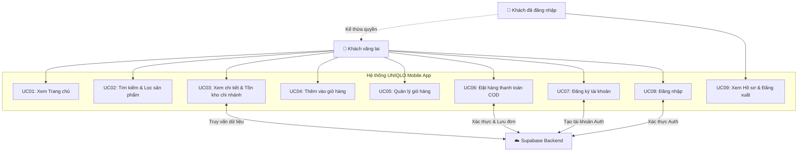

# TÀI LIỆU THIẾT KẾ USE CASE - ĐỒ ÁN UNIQLO MOBILE (NHÓM 23)

## 1. TỔNG QUAN VỀ HỆ THỐNG
Tài liệu này mô tả các Trường hợp sử dụng (Use Cases) của ứng dụng di động **UNIQLO Mobile App**. Hệ thống giúp người dùng khám phá danh mục sản phẩm, kiểm tra tồn kho theo từng chi nhánh, quản lý giỏ hàng và đặt hàng theo hình thức thanh toán COD.

---

## 2. DANH SÁCH TÁC NHÂN (ACTORS)
* **Khách vãng lai (Guest User):** Người dùng chưa đăng nhập, xem danh mục, kiểm tra tồn kho và đặt hàng demo.
* **Khách đã đăng nhập (Authenticated Customer):** Người dùng có tài khoản đã đăng nhập qua Supabase Auth.
* **Hệ thống Supabase (External Backend System):** Hệ thống lưu trữ dữ liệu sản phẩm, tồn kho kho hàng chi nhánh và quản lý xác thực tài khoản.

---

## 3. DANH SÁCH USE CASES

| Mã UC | Tên Use Case | Tác nhân chính | Màn hình tương ứng (Expo Router) |
| :--- | :--- | :--- | :--- |
| **UC01** | Xem Trang chủ & Sản phẩm nổi bật | Guest / Customer | `src/app/index.tsx` |
| **UC02** | Tìm kiếm & Lọc sản phẩm | Guest / Customer | `src/app/products/index.tsx` |
| **UC03** | Xem chi tiết sản phẩm & Tồn kho chi nhánh | Guest / Customer | `src/app/products/[id].tsx` |
| **UC04** | Thêm sản phẩm vào giỏ hàng | Guest / Customer | `src/app/products/[id].tsx` |
| **UC05** | Quản lý giỏ hàng | Guest / Customer | `src/app/cart.tsx` |
| **UC06** | Đặt hàng thanh toán COD | Guest / Customer | `src/app/checkout.tsx` |
| **UC07** | Đăng ký tài khoản | Guest User | `src/app/auth/register.tsx` |
| **UC08** | Đăng nhập tài khoản | Guest User | `src/app/auth/login.tsx` |
| **UC09** | Quản lý hồ sơ cá nhân & Đăng xuất | Authenticated Customer | `src/app/account.tsx` |

---

## 4. SƠ ĐỒ USE CASE (USE CASE DIAGRAM)

---

## 5. MÔ TẢ CHI TIẾT CÁC USE CASE CHÍNH

### 5.1. UC03: Xem chi tiết sản phẩm & Tồn kho chi nhánh
* **Tác nhân:** Khách vãng lai / Khách đã đăng nhập.
* **Màn hình thực thi:** `src/app/products/[id].tsx`
* **Tiền điều kiện:** Sản phẩm tồn tại trong danh mục hệ thống.
* **Luồng chính (Main Flow):**
  1. Người dùng chọn 1 sản phẩm từ danh mục.
  2. Hệ thống tải dữ liệu giá, mô tả, hình ảnh và danh sách biến thể (Size, Màu sắc).
  3. Người dùng chọn **Kích thước**, **Màu sắc** mong muốn.
  4. Người dùng chọn **Chi nhánh nhận hàng**.
  5. Hệ thống tính toán và hiển thị số lượng **Tồn kho khả dụng** tương ứng với tổ hợp (SKU + Chi nhánh) đã chọn.
* **Luồng ngoại lệ (Alternative Flow):**
  * Nếu hết hàng (`stock = 0`), hệ thống thông báo "Đã hết hàng" và vô hiệu hóa nút "Thêm vào giỏ hàng".

---

### 5.2. UC06: Đặt hàng thanh toán COD
* **Tác nhân:** Khách vãng lai / Khách đã đăng nhập.
* **Màn hình thực thi:** `src/app/checkout.tsx`
* **Tiền điều kiện:** Giỏ hàng có ít nhất 1 sản phẩm.
* **Luồng chính (Main Flow):**
  1. Người dùng bấm "Tiến hành đặt hàng" từ giỏ hàng.
  2. Màn hình checkout hiển thị form nhập thông tin giao hàng (*Họ tên*, *Số điện thoại*, *Địa chỉ*).
  3. Hệ thống hiển thị phương thức thanh toán mặc định: **COD (Thanh toán khi nhận hàng)**.
  4. Người dùng xác nhận đơn hàng.
  5. Hệ thống validate thông tin, thông báo đặt hàng thành công và làm sạch giỏ hàng.
* **Luồng ngoại lệ (Alternative Flow):**
  * Nếu thông tin nhập thiếu hoặc sai định dạng (ví dụ: SĐT sai), hệ thống báo lỗi tại từng ô input.

---

### 5.3. UC08: Đăng nhập tài khoản
* **Tác nhân:** Khách vãng lai.
* **Màn hình thực thi:** `src/app/auth/login.tsx`
* **Luồng chính (Main Flow):**
  1. Người dùng mở trang Tài khoản và chọn "Đăng nhập".
  2. Người dùng nhập Email và Mật khẩu.
  3. Hệ thống gửi yêu cầu xác thực tới Supabase Auth.
  4. Sau khi xác thực thành công, hệ thống chuyển về màn hình Tài khoản (`src/app/account.tsx`).
